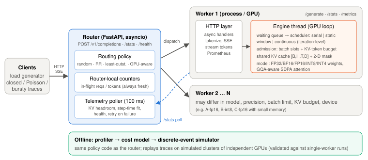
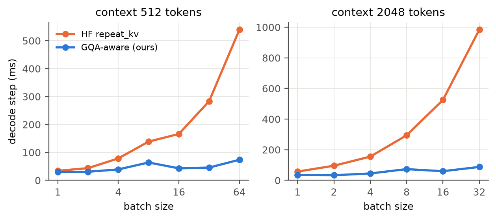
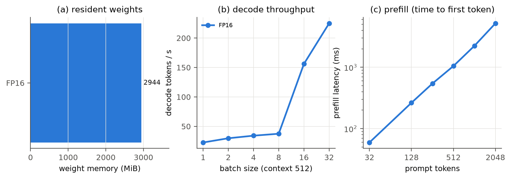

# Design and Evaluation of GPU-Efficient Distributed Infrastructure for Large Language Model Inference

**CSCE 685 Directed Studies, final report** · Soumyadip Sarkar

> **Status (in progress).** The serving framework is complete and tested. This report
> currently covers the kernel-level and precision experiments (E0, E1). The quality,
> batching, scaling, routing, fault-tolerance and simulation experiments (E2–E7) are
> implemented and scripted, and their results will be added here as each run completes.
> See [Experiment status](#9-experiment-status).

---

## Abstract

Serving a large language model (LLM) efficiently is a systems problem as much as a
modelling problem. Latency and throughput depend on numerical precision, on how
concurrent requests share the accelerator, and on how a gateway spreads requests
across model replicas. This project builds **`llmserve`**, a small but complete,
reproducible LLM serving stack. It contains:

1. a weight-only **INT8/INT4 quantizer**;
2. an inference **engine** with three batching policies (serial, request-level
   windowed batching, and iteration-level *continuous* batching) over a shared KV cache;
3. HTTP **model workers** that expose runtime telemetry;
4. an asynchronous **router** with four policies, including a *GPU-aware* policy that
   scores workers by estimated completion time from queue depth, batch occupancy,
   KV-cache headroom, model configuration and recent step latency;
5. a **discrete-event simulator**, calibrated from measured profiles and sharing the
   router's policy code;
6. a benchmark harness (trace generator, streaming load client, profiler, quality evaluation).

The experiments so far ran on an Apple M4 GPU. They show that the stock Hugging Face
grouped-query attention path was the dominant decode cost at realistic batch sizes:
replacing it with a GQA-aware kernel call makes decode steps **up to 11.2× faster**
with bit-identical outputs. Weight quantization cuts resident model memory by
**2.0× (INT8)** and **3.6× (INT4)**. Without fused low-bit kernels, however, the
per-step dequantization makes decode **3–5× slower** than FP16 at small batch sizes.
The gap narrows as batch size grows, because the dequantization cost is paid once
per step regardless of how many sequences are in the batch.

---

## 1. Introduction and research question

LLM inference has two phases. **Prefill** processes the whole prompt in parallel and
produces the first token. **Decode** then generates one token per forward pass,
reading every model weight and the growing **key–value (KV) cache** each time. A single
decode step does very little arithmetic per byte moved, so one sequence leaves a GPU
mostly idle; batching many sequences into one forward pass amortizes the weight
reads. Serving systems therefore face coupled decisions:

* **Precision.** Lower-precision weights free memory, which can hold more KV cache and
  therefore larger batches, but may cost speed (dequantization) or quality.
* **Batching.** When to form batches, and whether sequences may join or leave a running
  batch, trades throughput against time-to-first-token (TTFT) and tail latency.
* **Routing.** A gateway that ignores worker state can send requests to a replica that
  is slow, saturated or out of KV memory.

The research question from the proposal:

> *How can quantization, dynamic batching, and GPU-aware distributed scheduling be
> combined to improve the latency, throughput, memory efficiency, and scalability of
> LLM inference while preserving useful model quality?*

## 2. Background and related work

* **Continuous batching.** Orca [1] introduced iteration-level scheduling, in which the
  batch is re-formed at every decode step. vLLM [2] added PagedAttention so the KV cache
  can be allocated without fragmentation. Sarathi-Serve [3] studies the prefill–decode
  interference that continuous batching creates.
* **Quantization.** LLM.int8() [4], GPTQ [5] and AWQ [6] show that 8-bit and 4-bit
  weights can keep quality close to FP16. Their speedups depend on fused low-bit GEMM
  kernels (bitsandbytes, Marlin, AWQ GEMM) that dequantize inside the matrix multiply.
* **Grouped-query attention (GQA)** [7] shares each KV head among *G* query heads,
  shrinking the KV cache *G*-fold (Qwen2.5-0.5B: 14 query heads, 2 KV heads, *G* = 7).
* **Load balancing.** Join-the-shortest-queue and power-of-two-choices [8] are the
  classic baselines. Recent LLM gateways also route on KV-cache and queue signals
  (e.g. DistServe [9] and Splitwise [10] for phase-aware placement).

## 3. System design



### 3.1 Quantizer (`llmserve/quant.py`)

Weight-only, post-training, round-to-nearest quantization, implemented from scratch so
it behaves the same on CUDA, Apple MPS and CPU:

* **INT8**: symmetric, one FP16 scale per output channel, `W ≈ q·s`, q ∈ [−127, 127].
* **INT4**: asymmetric, group-wise (64 input columns per group), `W ≈ (q − z)·s`,
  two 4-bit codes packed per byte, one FP16 scale and zero point per group. This is the
  storage layout of GPTQ/AWQ checkpoints, filled here by round-to-nearest.
* All `nn.Linear` layers are replaced. The **tied input embedding and LM head share
  one quantized tensor** (`QuantEmbedding` dequantizes only the looked-up rows). This
  matters for small models: the 151,936 × 896 vocabulary matrix is 28% of
  Qwen2.5-0.5B's parameters.
* Activations stay in FP16, and weights are dequantized just before each matmul. On
  CUDA, `--quant-backend bnb` swaps in bitsandbytes kernels instead.

### 3.2 Engine and batching (`llmserve/engine.py`)

Each worker owns one model replica and one scheduling thread (the "GPU loop").
Requests arrive through a thread-safe inbox and return tokens through callbacks.

| Policy | Batch formation | Joins a running batch? |
|---|---|---|
| `serial` | 1 request at a time | – |
| `static` | wait until `max_batch` requests are queued or the oldest has waited `window_ms` | no: the batch runs until its longest member finishes |
| `continuous` | before every decode step, admit queued requests while slots and KV budget allow | yes, and finished requests leave immediately |

**KV-cache layout.** All running sequences share one Hugging Face `DynamicCache`
(`[B, kv_heads, T, head_dim]` per layer) plus a 2-D attention mask `[B, T]`:

* Newly admitted requests are prefilled together as a **right-padded** group. Left
  padding would create fully masked query rows, and on MPS those produce NaNs inside
  SDPA that poison the cache.
* The new group is then **left-padded with zero KV** to the running batch's length and
  concatenated along the batch axis.
* Positions are passed explicitly, so rotary embeddings see each sequence's true
  positions despite the padding.
* When sequences finish, their rows are dropped and leading columns that are padding
  for every remaining row are trimmed.

**Admission control** reserves `prompt + max_tokens` KV tokens per request against a
configurable `kv_budget_tokens`. That budget is the "available GPU memory" signal the
router sees.

**Correctness.** With FP32 weights, outputs from all three policies, under staggered
arrivals that force joins into running batches, are *token-for-token identical* to
unbatched greedy decoding (`tests/test_engine.py`, and checked on the real model). In
FP16, 1 of 5 test prompts diverged at a near-tie arg-max when batched. That is
expected floating-point non-associativity in batched kernels, not a scheduling error.

**Telemetry** (`/stats`, `/metrics`) covers:

* queue depth, active batch size, KV reserved/free;
* physical vs. useful KV tokens (the padding overhead);
* device memory and engine busy fraction;
* a least-squares **step-time model** `t(b) = a + c·b` fitted online from recent decode steps;
* prefill seconds per token;
* EWMAs of TTFT, end-to-end latency and per-token latency.

### 3.3 GQA-aware attention (`llmserve/attention.py`)

Profiling the engine showed decode steps of 230 ms at batch 16 and context 1024,
against 30 ms at batch 1. The cause is Hugging Face's `repeat_kv`, which materializes
a 7× copy of each layer's K and V on every step:

| Operation (B=16, T=1024, one layer, FP16, MPS) | Time |
|---|---|
| SDPA attention kernel | 1.5 ms |
| `repeat_kv` on K (and the same again for V) | 3.4 ms each |

The patch folds the *G* query heads that share a KV head into the query-length axis
(`[B, H_kv, G·L, D]`) and broadcasts the mask, so SDPA reads the un-expanded cache.
The math is unchanged (unit-tested against the reference attention).

### 3.4 Workers, router and policies

**Worker** (`llmserve/worker.py`): FastAPI service with `/generate` (JSON or SSE
token streaming), `/stats`, `/health` and `/metrics` (Prometheus).

**Router** (`llmserve/router.py`): asynchronous gateway exposing `/v1/completions`.

* Polls every worker's `/stats` every 100 ms.
* Keeps **router-local in-flight counters**, updated synchronously on dispatch and
  completion, so queue length is never stale.
* Marks a worker unhealthy after 2 failed polls.
* Retries a request on another worker if the chosen one fails before streaming starts.

**Policies** (`llmserve/policies.py`): `random`, `round_robin`, `least_outstanding`
(join-the-shortest-queue on local counts) and `gpu_aware`. The GPU-aware policy picks
the worker with the lowest estimated completion time:

```
batch      = min(n + 1, B)                              # n = in-flight on worker, B = max batch
queue_wait = max(0, n + 1 − B) / B · avg_len · t(B)     # slots free up as requests finish
mem_wait   = avg_len · t(B) / B      if KV headroom < prompt + max_tokens
estimate   = queue_wait + mem_wait + prefill_per_token · prompt + max_tokens · t(batch)
```

Workers that can never fit the request are excluded. The policy therefore uses every
signal named in the proposal:

| Signal | How it enters the estimate |
|---|---|
| Queue depth and active batch size | `n` |
| Available GPU memory | KV headroom |
| Model configuration (precision, size, hardware) | the fitted `t(b)` |
| Recent latency | `t(b)` is re-fitted continuously |

### 3.5 Simulator (`llmserve/sim/simulator.py`)

The live multi-worker experiments place several workers on one physical GPU, so they
compete for it. To study clusters of *independent* GPUs, and to repeat runs across many
random seeds, a discrete-event simulator replays traces through simulated workers:

* Each simulated worker mirrors the continuous-batching engine: FIFO admission,
  batch-slot and KV-budget limits, prefill at the start of an iteration, then one
  decode step.
* Step time is **interpolated from the measured (batch × context) grid**, so non-linear
  hardware effects carry over. Prefill time is interpolated from measured prompt lengths.
* The simulated router uses the same policy objects as the live router.

### 3.6 Benchmark harness (`bench/`)

**Workloads** (`bench/workload.py`) are built from WikiText-2 paragraphs wrapped in
summarization or explanation instructions, trimmed to target token lengths. Request
classes:

| Class | Prompt tokens | Output tokens |
|---|---|---|
| short | 32–128 | 32–64 |
| medium | 256–512 | 64–128 |
| long | 1024–1536 | 128–256 |

Mixes: *balanced* (50/35/15%) and *heavy-tail* (80% short, 20% long). Arrival
processes: closed-loop concurrency, Poisson, and *bursty* (a two-state
Markov-modulated Poisson process). Traces are seeded and saved as JSONL so every
configuration replays the identical workload.

**Load client** (`bench/client.py`) streams responses over SSE and records
client-side TTFT, end-to-end latency, time per output token (TPOT) and token counts,
while sampling every worker's telemetry.

## 4. Experimental setup

| | |
|---|---|
| Hardware | Apple M4: 10-core CPU (4P + 6E), **8-core GPU**, 16 GB unified memory |
| Software | macOS (Darwin 25.6), Python 3.11, PyTorch 2.5.1 (MPS backend), Transformers 4.46.3, FastAPI/uvicorn, httpx |
| Models | Qwen2.5-0.5B-Instruct (494M params, 24 layers, GQA 14/2); Qwen2.5-1.5B-Instruct (1.54B, 28 layers, GQA 12/2) |
| Precisions | FP32, BF16, FP16, INT8 (W8), INT4 (W4, g64), INT4 with FP16 embedding/head |
| Metrics | P50/P95/P99 end-to-end latency, TTFT, TPOT, output tokens/s, requests/s, device memory, engine busy fraction, KV padding overhead |

**No CUDA GPU was available.** The framework supports CUDA (device selection, NVML
utilization, bitsandbytes), but every number here comes from the Apple GPU, whose
kernel library differs from cuBLAS/FlashAttention. Absolute numbers are
hardware-specific; the methodology and the relative trends are the contribution.

## 5. Results

### E0. Kernel ablation: GQA-aware attention



*Figure 1. Decode-step latency, Qwen2.5-0.5B FP16: stock HF attention (`repeat_kv`) vs.
the GQA-aware path.*

| Context | Batch 1 | Batch 8 | Batch 16 | Batch 32 |
|---|---|---|---|---|
| 512 | 34 → 30 ms (1.15×) | 139 → 64 ms (2.2×) | 166 → 43 ms (3.9×) | 284 → 46 ms (**6.2×**) |
| 1024 | 38 → 31 ms (1.22×) | 187 → 68 ms (2.8×) | 275 → 45 ms (6.1×) | 540 → 59 ms (**9.1×**) |
| 2048 | 57 → 35 ms (1.66×) | 294 → 73 ms (4.0×) | 525 → 60 ms (8.8×) | 983 → 88 ms (**11.2×**) |

* With stock attention, step time grows roughly linearly in batch × context, so
  batching barely raised throughput: about 59 tok/s at B = 32, T = 1024.
* With the patch, the step stays near the batch-1 floor of about 30 ms up to B = 32,
  so the same configuration reaches about 540 tok/s.
* This single fix changes the conclusion of every batching experiment that follows.
  The lesson: profile the attention path before tuning schedulers.

### E1. Precision: memory, prefill and decode


*Figure 2. Qwen2.5-0.5B: (a) resident weight memory, (b) decode throughput vs. batch
size at context 512, (c) prefill latency vs. prompt length.*

| Precision | Weights (MiB) | Decode, batch 1 (tok/s) | Decode, batch 32 (tok/s) | Best decode (tok/s) | Prefill, 512 tokens (ms) |
|---|---|---|---|---|---|
| FP32 | 1885 | 16.3 | 359 | 371 | 510 |
| BF16 | 942 | 21.1 | 527 | 736 | 234 |
| **FP16** | 942 | **33.7** | **699** | **867** | **233** |
| INT8 (W8) | 472 (−50%) | 8.4 | 214 | 351 | 552 |
| INT4 (W4, g64) | 265 (−72%) | 6.3 | 160 | 279 | 519 |
| INT4, FP16 emb/head | 452 (−52%) | 8.2 | 212 | 334 | 450 |

Observations:

1. **FP16 is the fastest format on this GPU.** BF16 is 15–37% slower at the same
   memory, likely because MPS BF16 kernels are less tuned. FP32 doubles memory and
   halves throughput.
2. **Quantization buys memory, not speed, without fused kernels.** INT8 halves and INT4
   cuts resident weights by 3.6×. Each decode step, though, pays a fixed cost to
   dequantize every weight: roughly 90 ms (INT8) and 130 ms (INT4) on top of a
   30 ms FP16 step. The cost is *independent of batch size*, so the relative penalty
   shrinks as batches grow (FP16/INT8 throughput ratio: 4.0× at B = 1, 2.5× at
   B = 64).
3. **The LM head dominates INT4 overhead.** Keeping the 136M-parameter tied
   embedding/LM head in FP16 removes about 40% of the INT4 per-step overhead
   (fixed cost 0.21 s → 0.12 s) at the price of 187 MiB more memory. Low-bit kernels
   matter most for the largest matrix.
4. **Kernel-shape cliffs.** Batch 8 is consistently *slower* than batch 16, for both
   models and every precision (0.5B FP16: 64 ms vs. 43 ms; 1.5B FP16: 214 ms vs.
   103 ms). MPS appears to choose a poor GEMM kernel at that shape. A scheduler that
   rounds batches up to an efficient size would benefit; the simulator inherits the
   effect because it interpolates the measured grid.
5. **Memory cliff.** Throughput collapses once a single process's KV working set
   exceeds roughly 1 GB on this 16 GB unified-memory machine. FP32 at B = 64,
   T = 1024 takes 6.6 s per step, against 0.11 s at B = 32. This motivates the
   per-worker KV budget used for admission control.

**Qwen2.5-1.5B FP16** (2,944 MiB of weights, 28 KiB of KV per token): prefill takes
1.05 s for 512 tokens and 5.2 s for 2048 tokens. Decode at context 512 takes 44 ms per
step at batch 1 (23 tok/s) and 142 ms at batch 32 (225 tok/s). The 1.5B INT8/INT4
profiles were interrupted and will be added.



*Figure 3. Qwen2.5-1.5B FP16 profile.*

> **Measurement note.** The first-pass 0.5B FP32, BF16 and INT8 profiles ran while
> other jobs briefly used the machine. All 0.5B profiles will be re-measured on an idle
> GPU (`scripts/reprofile_clean.sh`) and this table updated. The qualitative
> conclusions above do not depend on those runs.

### E2–E7. Remaining experiments

These are implemented and scripted; their results will be added as each completes.

| ID | Experiment | Design |
|---|---|---|
| E2 | Quality vs. precision | WikiText-2 perplexity (40 × 1024 tokens); ARC-Easy zero-shot accuracy (2,376 questions, log-likelihood); greedy-output agreement with FP32 on 48 workload prompts |
| E3 | Batching | Single worker; serial vs. static (B = 8/32, 50 ms window) vs. continuous (B = 8/32/64); closed-loop concurrency 1–64; open-loop window sweep 0–400 ms |
| E4 | Scaling | 1, 2 and 3 replicated workers behind the router; concurrency 4–128; saturation point |
| E5 | Routing (live) | Heterogeneous pool (FP16; INT8; memory-starved FP16) and homogeneous pool; 4 policies × Poisson / bursty / heavy-tail traces |
| E6 | Fault tolerance | Kill 1 of 3 workers mid-run; failed requests, retries and recovery |
| E7 | Routing at scale (simulated) | 8-GPU heterogeneous and homogeneous clusters; offered-load sweep; 5 seeds; telemetry-staleness sensitivity; validated against the single-worker live runs |

## 6. Discussion (so far)

* **Find the bottleneck before optimizing policy.** The largest single gain in the
  project so far (up to 11×) came from removing a memory copy in attention, not from
  scheduling. With it in place, decode cost is nearly flat up to batch 32, which is
  what makes batching and batch-aware routing worthwhile at all.
* **Quantization is a memory lever.** On hardware without fused low-bit GEMMs it should
  be used where memory, not compute, is the binding constraint: a larger model on a
  small device, or more KV cache for more concurrent sequences. On a CUDA deployment,
  bitsandbytes/Marlin kernels (supported via `--quant-backend bnb`) would shift this
  trade-off.
* **Heterogeneity is the norm.** Precision, model size, batch-limit and memory
  differences produce workers whose speeds differ several-fold. That is the case where
  a router that knows each worker's step-time model should beat static policies; E5
  and E7 test it.

## 7. Limitations

* A single Apple-silicon GPU, not a CUDA cluster. Live multi-worker runs share one
  GPU; the simulator covers independent GPUs.
* Small models (0.5B/1.5B). Larger models make memory pressure, and so quantization,
  more important.
* Round-to-nearest quantization without fused kernels. GPTQ/AWQ-calibrated weights
  with fused kernels would improve both quality and speed.
* A contiguous, padded KV cache rather than paged blocks. Padding overhead is measured
  and reported (E3).

## 8. Reproducing and extending

```bash
python3.11 -m venv .venv && source .venv/bin/activate
pip install -r requirements-dev.txt
pytest -q                                 # 14 tests; tiny random model on CPU, no download

python -m llmserve.worker --precision fp16 --policy continuous --max-batch 32 --port 8001
python -m llmserve.cluster configs/cluster_hetero.yaml      # 3 workers + GPU-aware router on :8000
curl -sN localhost:8000/v1/completions -H 'content-type: application/json' \
     -d '{"prompt":"Explain continuous batching.","max_tokens":64,"stream":true}'

scripts/run_all.sh                        # every experiment; finished steps are skipped
python -m analysis.figures                # all figures + report/tables.json
```

| Path | Contents |
|---|---|
| `llmserve/` | quantizer, GQA attention, engine, worker, router, policies, cluster launcher, simulator |
| `bench/` | workload generator, load client, profiler, quality evaluation, live + simulated experiment drivers |
| `analysis/figures.py` | every figure and table in this report |
| `configs/` | cluster YAMLs (homogeneous, heterogeneous, example 4-GPU CUDA) |
| `deploy/` | CUDA Dockerfile and docker-compose (written for CUDA hosts; not exercised in this study) |
| `results/` | raw JSON for every run (configuration, summary, per-request timings, telemetry time series) |
| `tests/` | quantizer, engine-equivalence, GQA-patch, policy and simulator tests |

**Extension points:**

* New routing policy: subclass `Policy` and register it in `POLICIES`. It is then used
  by the router, the simulator and the experiments.
* New hardware: run `scripts/run_profiles.sh` there; the simulator recalibrates from
  the new profiles.

## 9. Experiment status

| Experiment | Status |
|---|---|
| E0 GQA kernel ablation | ✅ done |
| E1 precision profiles, 0.5B (6 formats) | ✅ done (clean re-measure queued) |
| E1 precision profiles, 1.5B | FP16 ✅ · INT8/INT4 pending |
| E2 quality | ⏳ pending |
| E3 batching | ⏳ pending |
| E4 scaling | ⏳ pending |
| E5 routing (live) | ⏳ pending |
| E6 fault tolerance | ⏳ pending |
| E7 simulation | ⏳ pending |

## References

1. G.-I. Yu et al. *Orca: A Distributed Serving System for Transformer-Based Generative Models.* OSDI 2022.
2. W. Kwon et al. *Efficient Memory Management for Large Language Model Serving with PagedAttention.* SOSP 2023.
3. A. Agrawal et al. *Taming Throughput-Latency Tradeoff in LLM Inference with Sarathi-Serve.* OSDI 2024.
4. T. Dettmers et al. *LLM.int8(): 8-bit Matrix Multiplication for Transformers at Scale.* NeurIPS 2022.
5. E. Frantar et al. *GPTQ: Accurate Post-Training Quantization for Generative Pre-trained Transformers.* ICLR 2023.
6. J. Lin et al. *AWQ: Activation-aware Weight Quantization for LLM Compression and Acceleration.* MLSys 2024.
7. J. Ainslie et al. *GQA: Training Generalized Multi-Query Transformer Models from Multi-Head Checkpoints.* EMNLP 2023.
8. M. Mitzenmacher. *The Power of Two Choices in Randomized Load Balancing.* IEEE TPDS 2001.
9. Y. Zhong et al. *DistServe: Disaggregating Prefill and Decoding for Goodput-optimized LLM Serving.* OSDI 2024.
10. P. Patel et al. *Splitwise: Efficient Generative LLM Inference Using Phase Splitting.* ISCA 2024.
