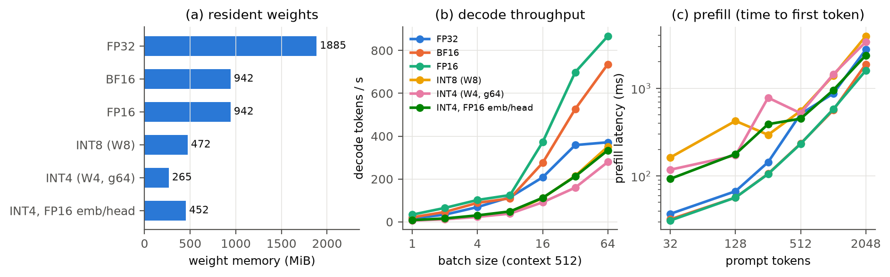
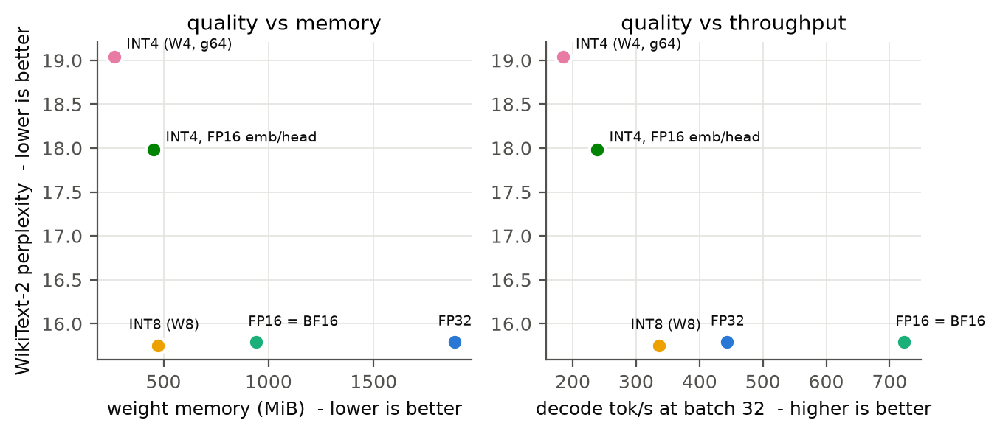
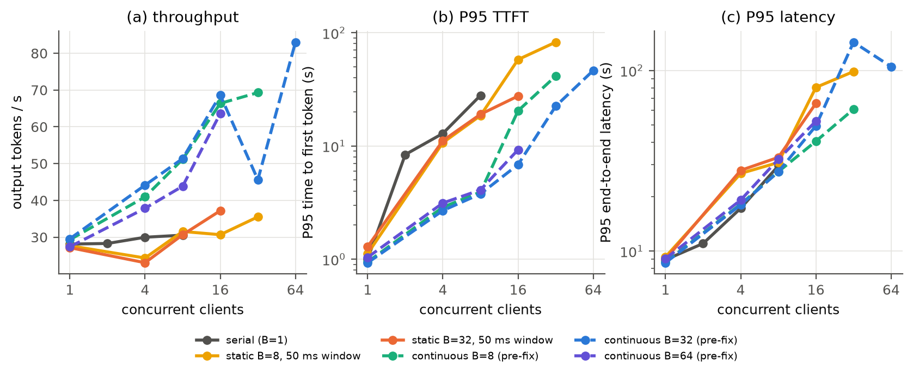

# Design and Evaluation of GPU-Efficient Distributed Infrastructure for Large Language Model Inference

**CSCE 685 Directed Studies, final report** · Soumyadip Sarkar

> **Status (paused, in progress).** The serving framework is complete and tested. This
> report covers the kernel-level, precision, quality and batching experiments (E0–E3).
> The scaling, routing, fault-tolerance and simulation experiments (E4–E7) are
> implemented and scripted but not yet run. See
> [Experiment status](#9-experiment-status) and [Resuming the experiments](#10-resuming-the-experiments).

---

## Abstract

Serving a large language model (LLM) efficiently is a systems problem as much as a
modelling problem. Latency and throughput depend on numerical precision, on how
concurrent requests share the accelerator, and on how a gateway spreads requests
across model replicas. This project builds **`llmserve`**, a small but complete,
reproducible LLM serving stack. It contains:

1. a weight-only **INT8/INT4 quantizer**;
2. an inference **engine** with three batching policies (serial, request-level
   windowed batching, and iteration-level *continuous* batching) over a shared KV cache;
3. HTTP **model workers** that expose runtime telemetry;
4. an asynchronous **router** with four policies, including a *GPU-aware* policy that
   scores workers by estimated completion time from queue depth, batch occupancy,
   KV-cache headroom, model configuration and recent step latency;
5. a **discrete-event simulator**, calibrated from measured profiles and sharing the
   router's policy code;
6. a benchmark harness (trace generator, streaming load client, profiler, quality evaluation).

The experiments so far ran on an Apple M4 GPU. They show that the stock Hugging Face
grouped-query attention path was the dominant decode cost at realistic batch sizes:
replacing it with a GQA-aware kernel call makes decode steps **up to 10.9× faster**
with bit-identical outputs. Weight quantization cuts resident model memory by
**2.0× (INT8)** and **3.6× (INT4)**. Without fused low-bit kernels, however, the
per-step dequantization makes decode **2× (INT8) to 4× (INT4) slower** than FP16 at batch 1.
The gap narrows as batch size grows, because the dequantization cost is paid once
per step regardless of how many sequences are in the batch.
INT8 is quality-neutral (perplexity and ARC-Easy accuracy unchanged vs. FP32), while
round-to-nearest INT4 costs 21% perplexity and 2.3 ARC-Easy points. A 1.5B model at INT4 still beats
the 0.5B model at FP16 in less memory. Continuous batching reaches **2.3× the peak
throughput** of request-level batching and cuts median time-to-first-token by an order
of magnitude at moderate load. It also exposed an allocator pathology: the
ever-changing KV-cache shape made the GPU's caching allocator reserve more memory than
the machine has. A periodic cache release fixed it and raised throughput by about 35%.

---

## 1. Introduction and research question

LLM inference has two phases. **Prefill** processes the whole prompt in parallel and
produces the first token. **Decode** then generates one token per forward pass,
reading every model weight and the growing **key–value (KV) cache** each time. A single
decode step does very little arithmetic per byte moved, so one sequence leaves a GPU
mostly idle; batching many sequences into one forward pass amortizes the weight
reads. Serving systems therefore face coupled decisions:

* **Precision.** Lower-precision weights free memory, which can hold more KV cache and
  therefore larger batches, but may cost speed (dequantization) or quality.
* **Batching.** When to form batches, and whether sequences may join or leave a running
  batch, trades throughput against time-to-first-token (TTFT) and tail latency.
* **Routing.** A gateway that ignores worker state can send requests to a replica that
  is slow, saturated or out of KV memory.

The research question from the proposal:

> *How can quantization, dynamic batching, and GPU-aware distributed scheduling be
> combined to improve the latency, throughput, memory efficiency, and scalability of
> LLM inference while preserving useful model quality?*

## 2. Background and related work

* **Continuous batching.** Orca [1] introduced iteration-level scheduling, in which the
  batch is re-formed at every decode step. vLLM [2] added PagedAttention so the KV cache
  can be allocated without fragmentation. Sarathi-Serve [3] studies the prefill–decode
  interference that continuous batching creates.
* **Quantization.** LLM.int8() [4], GPTQ [5] and AWQ [6] show that 8-bit and 4-bit
  weights can keep quality close to FP16. Their speedups depend on fused low-bit GEMM
  kernels (bitsandbytes, Marlin, AWQ GEMM) that dequantize inside the matrix multiply.
* **Grouped-query attention (GQA)** [7] shares each KV head among *G* query heads,
  shrinking the KV cache *G*-fold (Qwen2.5-0.5B: 14 query heads, 2 KV heads, *G* = 7).
* **Load balancing.** Join-the-shortest-queue and power-of-two-choices [8] are the
  classic baselines. Recent LLM gateways also route on KV-cache and queue signals
  (e.g. DistServe [9] and Splitwise [10] for phase-aware placement).

## 3. System design


### 3.1 Quantizer (`llmserve/quant.py`)

Weight-only, post-training, round-to-nearest quantization, implemented from scratch so
it behaves the same on CUDA, Apple MPS and CPU:

* **INT8**: symmetric, one FP16 scale per output channel, `W ≈ q·s`, q ∈ [−127, 127].
* **INT4**: asymmetric, group-wise (64 input columns per group), `W ≈ (q − z)·s`,
  two 4-bit codes packed per byte, one FP16 scale and zero point per group. This is the
  storage layout of GPTQ/AWQ checkpoints, filled here by round-to-nearest.
* All `nn.Linear` layers are replaced. The **tied input embedding and LM head share
  one quantized tensor** (`QuantEmbedding` dequantizes only the looked-up rows). This
  matters for small models: the 151,936 × 896 vocabulary matrix is 28% of
  Qwen2.5-0.5B's parameters.
* Activations stay in FP16, and weights are dequantized just before each matmul. On
  CUDA, `--quant-backend bnb` swaps in bitsandbytes kernels instead.

### 3.2 Engine and batching (`llmserve/engine.py`)

Each worker owns one model replica and one scheduling thread (the "GPU loop").
Requests arrive through a thread-safe inbox and return tokens through callbacks.

| Policy | Batch formation | Joins a running batch? |
|---|---|---|
| `serial` | 1 request at a time | – |
| `static` | wait until `max_batch` requests are queued or the oldest has waited `window_ms` | no: the batch runs until its longest member finishes |
| `continuous` | before every decode step, admit queued requests while slots and KV budget allow | yes, and finished requests leave immediately |

**KV-cache layout.** All running sequences share one Hugging Face `DynamicCache`
(`[B, kv_heads, T, head_dim]` per layer) plus a 2-D attention mask `[B, T]`:

* Newly admitted requests are prefilled together as a **right-padded** group. Left
  padding would create fully masked query rows, and on MPS those produce NaNs inside
  SDPA that poison the cache.
* The new group is then **left-padded with zero KV** to the running batch's length and
  concatenated along the batch axis.
* Positions are passed explicitly, so rotary embeddings see each sequence's true
  positions despite the padding.
* When sequences finish, their rows are dropped and leading columns that are padding
  for every remaining row are trimmed.

**Admission control** reserves `prompt + max_tokens` KV tokens per request against a
configurable `kv_budget_tokens`. That budget is the "available GPU memory" signal the
router sees.

**Correctness.** With FP32 weights, outputs from all three policies, under staggered
arrivals that force joins into running batches, are *token-for-token identical* to
unbatched greedy decoding (`tests/test_engine.py`, and checked on the real model). In
FP16, 1 of 5 test prompts diverged at a near-tie arg-max when batched. That is
expected floating-point non-associativity in batched kernels, not a scheduling error.

**Telemetry** (`/stats`, `/metrics`) covers:

* queue depth, active batch size, KV reserved/free;
* physical vs. useful KV tokens (the padding overhead);
* device memory and engine busy fraction;
* a least-squares **step-time model** `t(b) = a + c·b` fitted online from recent decode steps;
* prefill seconds per token;
* EWMAs of TTFT, end-to-end latency and per-token latency.

### 3.3 GQA-aware attention (`llmserve/attention.py`)

Profiling the engine showed decode steps of 230 ms at batch 16 and context 1024,
against 30 ms at batch 1. The cause is Hugging Face's `repeat_kv`, which materializes
a 7× copy of each layer's K and V on every step:

| Operation (B=16, T=1024, one layer, FP16, MPS) | Time |
|---|---|
| SDPA attention kernel | 1.5 ms |
| `repeat_kv` on K (and the same again for V) | 3.4 ms each |

The patch folds the *G* query heads that share a KV head into the query-length axis
(`[B, H_kv, G·L, D]`) and broadcasts the mask, so SDPA reads the un-expanded cache.
The math is unchanged (unit-tested against the reference attention).

### 3.4 Workers, router and policies

**Worker** (`llmserve/worker.py`): FastAPI service with `/generate` (JSON or SSE
token streaming), `/stats`, `/health` and `/metrics` (Prometheus).

**Router** (`llmserve/router.py`): asynchronous gateway exposing `/v1/completions`.

* Polls every worker's `/stats` every 100 ms.
* Keeps **router-local in-flight counters**, updated synchronously on dispatch and
  completion, so queue length is never stale.
* Marks a worker unhealthy after 2 failed polls.
* Retries a request on another worker if the chosen one fails before streaming starts.

**Policies** (`llmserve/policies.py`): `random`, `round_robin`, `least_outstanding`
(join-the-shortest-queue on local counts) and `gpu_aware`. The GPU-aware policy picks
the worker with the lowest estimated completion time:

```
batch      = min(n + 1, B)                              # n = in-flight on worker, B = max batch
queue_wait = max(0, n + 1 − B) / B · avg_len · t(B)     # slots free up as requests finish
mem_wait   = avg_len · t(B) / B      if KV headroom < prompt + max_tokens
estimate   = queue_wait + mem_wait + prefill_per_token · prompt + max_tokens · t(batch)
```

Workers that can never fit the request are excluded. The policy therefore uses every
signal named in the proposal:

| Signal | How it enters the estimate |
|---|---|
| Queue depth and active batch size | `n` |
| Available GPU memory | KV headroom |
| Model configuration (precision, size, hardware) | the fitted `t(b)` |
| Recent latency | `t(b)` is re-fitted continuously |

### 3.5 Simulator (`llmserve/sim/simulator.py`)

The live multi-worker experiments place several workers on one physical GPU, so they
compete for it. To study clusters of *independent* GPUs, and to repeat runs across many
random seeds, a discrete-event simulator replays traces through simulated workers:

* Each simulated worker mirrors the continuous-batching engine: FIFO admission,
  batch-slot and KV-budget limits, prefill at the start of an iteration, then one
  decode step.
* Step time is **interpolated from the measured (batch × context) grid**, so non-linear
  hardware effects carry over. Prefill time is interpolated from measured prompt lengths.
* The simulated router uses the same policy objects as the live router.

### 3.6 Benchmark harness (`bench/`)

**Workloads** (`bench/workload.py`) are built from WikiText-2 paragraphs wrapped in
summarization or explanation instructions, trimmed to target token lengths. Request
classes:

| Class | Prompt tokens | Output tokens |
|---|---|---|
| short | 32–128 | 32–64 |
| medium | 256–512 | 64–128 |
| long | 1024–1536 | 128–256 |

Mixes: *balanced* (50/35/15%) and *heavy-tail* (80% short, 20% long). Arrival
processes: closed-loop concurrency, Poisson, and *bursty* (a two-state
Markov-modulated Poisson process). Traces are seeded and saved as JSONL so every
configuration replays the identical workload.

**Load client** (`bench/client.py`) streams responses over SSE and records
client-side TTFT, end-to-end latency, time per output token (TPOT) and token counts,
while sampling every worker's telemetry.

## 4. Experimental setup

| | |
|---|---|
| Hardware | Apple M4: 10-core CPU (4P + 6E), **8-core GPU**, 16 GB unified memory |
| Software | macOS (Darwin 25.6), Python 3.11, PyTorch 2.5.1 (MPS backend), Transformers 4.46.3, FastAPI/uvicorn, httpx |
| Models | Qwen2.5-0.5B-Instruct (494M params, 24 layers, GQA 14/2); Qwen2.5-1.5B-Instruct (1.54B, 28 layers, GQA 12/2) |
| Precisions | FP32, BF16, FP16, INT8 (W8), INT4 (W4, g64), INT4 with FP16 embedding/head |
| Metrics | P50/P95/P99 end-to-end latency, TTFT, TPOT, output tokens/s, requests/s, device memory, engine busy fraction, KV padding overhead |

**No CUDA GPU was available.** The framework supports CUDA (device selection, NVML
utilization, bitsandbytes), but every number here comes from the Apple GPU, whose
kernel library differs from cuBLAS/FlashAttention. Absolute numbers are
hardware-specific; the methodology and the relative trends are the contribution.

## 5. Results

### E0. Kernel ablation: GQA-aware attention


*Figure 1. Decode-step latency, Qwen2.5-0.5B FP16: stock HF attention (`repeat_kv`) vs.
the GQA-aware path.*

| Context | Batch 1 | Batch 8 | Batch 16 | Batch 32 |
|---|---|---|---|---|
| 512 | 31 → 30 ms (1.0×) | 128 → 61 ms (2.1×) | 152 → 42 ms (3.6×) | 256 → 44 ms (**5.8×**) |
| 1024 | 36 → 30 ms (1.2×) | 165 → 60 ms (2.7×) | 249 → 41 ms (6.0×) | 478 → 53 ms (**9.0×**) |
| 2048 | 54 → 31 ms (1.8×) | 270 → 65 ms (4.1×) | 462 → 50 ms (9.2×) | 902 → 83 ms (**10.9×**) |

* With stock attention, step time grows roughly linearly in batch × context, so
  batching barely raised throughput: about 67 tok/s at B = 32, T = 1024.
* With the patch, the step stays near the batch-1 floor of about 30 ms up to B = 32,
  so the same configuration reaches about 600 tok/s.
* This single fix changes the conclusion of every batching experiment that follows.
  The lesson: profile the attention path before tuning schedulers.

### E1. Precision: memory, prefill and decode



*Figure 2. Qwen2.5-0.5B: (a) resident weight memory, (b) decode throughput vs. batch
size at context 512, (c) prefill latency vs. prompt length.*

| Precision | Weights (MiB) | Decode, batch 1 (tok/s) | Decode, batch 32 (tok/s) | Best decode (tok/s) | Prefill, 512 tokens (ms) |
|---|---|---|---|---|---|
| FP32 | 1885 | 29.2 | 443 | 470 | 249 |
| BF16 | 942 | 33.9 | 722 | 972 | 230 |
| FP16 | 942 | 33.0 | 722 | 972 | 234 |
| INT8 (W8) | 472 (−50%) | 15.9 | 337 | 519 | 276 |
| INT4 (W4, g64) | 265 (−72%) | 7.6 | 185 | 307 | 453 |
| INT4, FP16 emb/head | 452 (−52%) | 8.2 | 238 | 381 | 413 |

All profiles were measured on an otherwise idle GPU. A first pass that overlapped with
other jobs is kept in `results/profile/first_pass/` for transparency; it had
under-reported BF16, FP32 and INT8 speed by up to 2×.

Observations:

1. **FP16 and BF16 are equally fast** and are the best formats on this GPU. FP32
   doubles weight and KV memory and costs 12% (batch 1) to 39% (batch 32) of
   throughput.
2. **Quantization buys memory, not speed, without fused kernels.** INT8 halves and INT4
   cuts resident weights by 3.6×. Each decode step, though, pays a fixed cost to
   dequantize every weight: about 33 ms (INT8) and 100 ms (INT4) on top of a 30 ms
   FP16 step. The cost is *independent of batch size*, so the relative penalty shrinks
   as batches grow:

   | Throughput ratio | Batch 1 | Batch 64 |
   |---|---|---|
   | FP16 / INT8 | 2.1× | 1.9× |
   | FP16 / INT4 | 4.3× | 3.2× |

3. **The LM head is a large part of the INT4 overhead.** Keeping the 136M-parameter
   tied embedding/LM head in FP16 makes INT4 decode 8% faster at batch 1 and 29%
   faster at batch 32, for 187 MiB more memory. Low-bit kernels matter most for the
   largest matrix.
4. **Kernel-shape cliffs.** Batch 8 is consistently *slower* than batch 16, for both
   models and most precisions (0.5B FP16: 61 ms vs. 42 ms; 1.5B FP16: 214 ms vs.
   103 ms). MPS appears to choose a poor GEMM kernel at that shape. A scheduler that
   rounds batches up to an efficient size would benefit; the simulator inherits the
   effect because it interpolates the measured grid.
5. **Memory cliff.** Throughput collapses once a single process's KV working set
   exceeds roughly 1–1.5 GB on this 16 GB unified-memory machine. FP32 at B = 64,
   T = 1024 (1.6 GB of KV) takes 3.5 s per step, against 0.10 s at B = 32. This
   motivates the per-worker KV budget used for admission control.

**Qwen2.5-1.5B FP16** (2,944 MiB of weights, 28 KiB of KV per token): prefill takes
1.05 s for 512 tokens and 5.2 s for 2048 tokens. Decode at context 512 takes 44 ms per
step at batch 1 (23 tok/s) and 142 ms at batch 32 (225 tok/s).


*Figure 3. Qwen2.5-1.5B profile.*

### E2. Quality vs. precision

Three automated metrics on Qwen2.5-0.5B (`bench/quality.py`):

* **Perplexity** on WikiText-2 (test split, 40 × 1024 tokens).
* **ARC-Easy** zero-shot accuracy on all 2,376 test questions, scored by
  log-likelihood. 95% CI is about ±1.9 points.
* **Greedy agreement with FP32** on 33 chat prompts from the benchmark workload, 64
  generated tokens each, produced through the serving engine. *Exact* is the share of
  identical outputs; *prefix* is the mean share of each output generated before the
  first differing token.

| Precision | Weights (MiB) | Perplexity ↓ | ARC-Easy acc. ↑ | ARC acc. (len-norm) | Exact match vs FP32 | Prefix match vs FP32 |
|---|---|---|---|---|---|---|
| FP32 (reference) | 1885 | 15.79 | 65.6% | 60.4% | – | – |
| FP16 | 942 | 15.79 | 65.7% | 60.4% | 87.9% | 94.9% |
| BF16 | 942 | 15.80 | 65.4% | 60.2% | 69.7% | 81.2% |
| INT8 (W8) | 472 | 15.75 | 66.2% | 60.6% | 39.4% | 64.4% |
| INT4 (W4, g64) | 265 | 19.04 (+21%) | 63.3% (−2.3) | 58.8% | 0.0% | 14.5% |
| INT4, FP16 emb/head | 452 | 17.98 (+14%) | 63.7% (−1.9) | 58.1% | 6.1% | 19.6% |



*Figure 4. Quality–efficiency trade-off for Qwen2.5-0.5B. Left: perplexity vs. resident
weight memory. Right: perplexity vs. decode throughput at batch 32.*

Observations:

1. **16-bit and 8-bit weights are quality-neutral.** FP16, BF16 and INT8 match FP32
   perplexity within 0.3% and ARC-Easy accuracy within the confidence interval.
   Per-channel INT8 is a free 2× (FP16 → INT8) or 4× (FP32 → INT8) memory saving
   for this model.
2. **4-bit round-to-nearest has a visible cost** on a model this small: +21%
   perplexity and −2.3 points on ARC-Easy. Keeping the embedding/LM head in FP16
   recovers about a third of the perplexity loss for 187 MiB. Calibrated methods
   (GPTQ/AWQ) are the expected fix.
3. **Benchmark-neutral is not output-identical.** INT8 leaves both benchmarks
   unchanged, yet only 39% of its 64-token greedy outputs are word-for-word identical
   to FP32. Once a near-tie token flips, the continuation diverges. Even BF16 differs
   from FP32 on 30% of prompts. Systems that cache, test or compare exact outputs
   should pin the precision.
4. **Practical operating points on this hardware:**
   * FP16 when speed matters.
   * INT8 when memory is the constraint (no measurable quality loss, about half the
     speed).
   * INT4 only when nothing else fits.

**Qwen2.5-1.5B** (ARC-Easy on the first 1,000 test questions, 95% CI about ±2.7 points;
agreement measured against 1.5B FP16):

| Precision | Weights (MiB) | Perplexity ↓ | ARC-Easy acc. ↑ | Exact match vs FP16 | Prefix match vs FP16 |
|---|---|---|---|---|---|
| FP16 (reference) | 2944 | 10.65 | 76.2% | – | – |
| INT8 (W8) | 1474 | 10.69 | 75.6% | 60.6% | 70.7% |
| INT4 (W4, g64) | 828 | 12.30 (+15%) | 71.3% (−4.9) | 6.1% | 18.6% |

The pattern repeats at 3× the model size: INT8 is quality-neutral, and INT4
round-to-nearest is not. INT4's relative perplexity loss is smaller for the larger
model (+15% vs. +21%), but its ARC-Easy loss is larger (−4.9 vs. −2.3 points).
Perplexity alone would understate the downstream cost of 4-bit weights. The larger
model's INT8 outputs also stay closer to its FP16 outputs (60.6% vs. 39.4% exact
match; the 0.5B reference is FP32), consistent with larger models being more robust
to weight noise. The 1.5B model at INT4 (828 MiB) still scores better than the 0.5B
model at full precision (71.3% vs. 65.6% ARC-Easy, perplexity 12.3 vs. 15.8) in less
memory than 0.5B FP16 (942 MiB). Under a memory limit, a larger quantized model can
beat a smaller full-precision one.


### E3. Batching policies

Single FP16 worker, Qwen2.5-0.5B, closed-loop clients replaying the *balanced* trace.
That trace averages about 450 prompt tokens and 83 output tokens per request
(prefill-heavy, like summarization or RAG). Client-side measurements; output lengths
are fixed with `ignore_eos`. Each concurrency level replays the first
`min(max(4 × clients, 24), 256)` requests of the same trace.



*Figure 5. Throughput, P95 TTFT and P95 end-to-end latency vs. concurrent clients.
Solid lines: runs with the allocator fix (below). Dashed lines: continuous batching
from the first pass, before the fix. The leak only slowed runs down, so the dashed
lines are lower bounds.*

**Serial and static batching (with the allocator fix):**

| Policy | Clients | Output tok/s | Median TTFT (s) | Median e2e (s) | P95 e2e (s) | Mean active batch | KV padding overhead |
|---|---|---|---|---|---|---|---|
| serial | 1 | 28 | 0.2 | 1.7 | 9.0 | 0.9 | 0% |
| serial | 8 | 31 | 18.6 | 20.2 | 29.6 | 0.9 | 0% |
| static B=8, 50 ms | 8 | 32 | 7.5 | 16.9 | 30.9 | 3.8 | 88% |
| static B=8, 50 ms | 16 | 31 | 32.2 | 42.1 | 80.5 | 4.2 | 83% |
| static B=8, 50 ms | 32 | 36 | 73.6 | 83.2 | 98.5 | 4.4 | 124% |
| static B=32, 50 ms | 8 | 31 | 8.3 | 18.0 | 33.0 | 3.7 | 92% |
| static B=32, 50 ms | 16 | 37 | 18.9 | 36.6 | 65.7 | 7.4 | 107% |

**Continuous batching:**

| Batch limit | Clients | Output tok/s | Median TTFT (s) | Median e2e (s) | P95 e2e (s) |
|---|---|---|---|---|---|
| B=8 (pre-fix) | 8 | 51 | 0.43 | 8.7 | 27.5 |
| B=8 (pre-fix) | 16 | 66 | 9.9 | 21.1 | 40.5 |
| B=8 (pre-fix) | 32 | 69 | 34.3 | 43.3 | 61.0 |
| B=32 (pre-fix) | 4 | 44 | 0.11 | 4.0 | 18.0 |
| B=32 (pre-fix) | 16 | 69 | 0.82 | 15.8 | 49.3 |
| B=32 (pre-fix) | 64 | 83 | 32.9 | 60.0 | 104.8 |
| **B=64, with fix** | **16** | **86** | **0.47** | **12.8** | **34.6** |
| **B=64, with fix** | **32** | **82** | **0.81** | **28.7** | **78.9** |

The two "with fix" rows come from the fix-verification run (same trace, same
concurrency sequence on one worker). The full continuous-batching sweep with the fix
has not yet been re-run.

**Findings:**

1. **Serial saturates at about 30 tok/s.** Throughput does not grow with clients;
   every additional client only adds queueing (median TTFT 0.2 s → 18.6 s from 1 to
   8 clients).
2. **Request-level (static) batching barely helps on this workload: 31–37 tok/s.**
   * A batch must wait for its longest member, so batches drain and average occupancy
     stays at about 4–7 even with 16–32 clients.
   * Padding every prompt to the longest one inflates the stored KV cache by 83–124%.
3. **Static batching with B = 32 collapses at ≥ 32 clients on this 16 GB machine.**
   Large padded batches containing 1,500-token prompts drove the system into swap.
   Even with the allocator fix, the engine fell to about 1 decode step per second, so
   those levels were dropped from the sweep (the first-pass attempt is in
   `results/batching_allocator_bloat/`).
4. **Continuous batching wins on every metric once there are ≥ 4 clients.**

   | | Continuous (pre-fix) | Static | Serial |
   |---|---|---|---|
   | Throughput, 8 clients | 51 tok/s | 31–32 tok/s | 31 tok/s |
   | Median TTFT, 8 clients | 0.43 s | 7.5–8.3 s | 18.6 s |
   | Peak throughput (pre-fix) | 83 tok/s | 37 tok/s | 31 tok/s |
   | Peak throughput (with fix) | 86 tok/s | – | – |

   New requests join the running batch at the next step, and finished ones leave
   immediately. Peak throughput is 2.3× static and 2.8× serial.
5. **The batch limit trades throughput against TTFT.** At 16 clients, B = 8 queues
   requests (median TTFT 9.9 s) while B = 32 admits them all (0.8 s) at similar
   throughput.
6. **Prefill does not batch on this GPU.** Prefilling 8 × 512 tokens takes the same
   time as eight separate 512-token prefills (about 2,200 prompt tok/s). Batching only
   amortizes decode, and on a prefill-heavy trace that caps the achievable gain.

**Allocator bug found and fixed during this experiment.** The first pass is archived
in `results/batching_allocator_bloat/`.

* **Symptom.** Throughput fell as concurrency rose: continuous batching with B = 32
  dropped from 69 tok/s at 16 clients to 46 tok/s at 32 clients. The B = 64 worker
  eventually managed one decode step every ~10 s.
* **Cause.** The worker's MPS caching allocator had reserved **17.8 GB**, more than the
  machine's 16 GB of RAM, while under 1 GB was live. macOS was swapping 10.5 GB.
  Continuous batching gives the KV cache a new shape on every step (each new token
  extends it; sequences join and leave), and the allocator keeps every freed block of
  every size.
* **Fix.** Every 16 decode steps the engine compares reserved with allocated memory. If
  the gap exceeds 1 GiB, it returns cached blocks to the driver
  (`EngineConfig.cache_slack_bytes` in `engine.py`).
* **Effect.**

  | | Before | After |
  |---|---|---|
  | Reserved memory | 17.8 GB and growing | 1.1–1.3 GiB, steady |
  | 16 clients | 64 tok/s | **86 tok/s** |
  | 32 clients | stalled | **82 tok/s** |
  | Overhead of releasing memory | – | 0.4% of run time |

The lesson: a continuously batched, contiguous KV cache defeats a caching allocator.
This is one motivation for vLLM's fixed-size paged KV blocks.

### E4–E7. Remaining experiments

These are implemented and scripted (`bench/experiments.py`, `bench/sim_experiments.py`)
but have not been run yet.

| ID | Experiment | Design |
|---|---|---|
| E4 | Scaling | 1, 2 and 3 replicated workers behind the router; concurrency 4–128; saturation point |
| E5 | Routing (live) | Heterogeneous pool (FP16; INT8; memory-starved FP16) and homogeneous pool; 4 policies × Poisson / bursty / heavy-tail traces |
| E6 | Fault tolerance | Kill 1 of 3 workers mid-run; failed requests, retries and recovery |
| E7 | Routing at scale (simulated) | 8-GPU heterogeneous and homogeneous clusters; offered-load sweep; 5 seeds; telemetry-staleness sensitivity; validated against the single-worker live runs |

## 6. Discussion (so far)

* **Find the bottleneck before optimizing policy.** The largest single gain in the
  project so far (up to 10.9×) came from removing a memory copy in attention, not from
  scheduling. With it in place, decode cost is nearly flat up to batch 32, which is
  what makes batching and batch-aware routing worthwhile at all.
* **Quantization is a memory lever.** On hardware without fused low-bit GEMMs it should
  be used where memory, not compute, is the binding constraint: a larger model on a
  small device, or more KV cache for more concurrent sequences. On a CUDA deployment,
  bitsandbytes/Marlin kernels (supported via `--quant-backend bnb`) would shift this
  trade-off.
* **Heterogeneity is the norm.** Precision, model size, batch-limit and memory
  differences produce workers whose speeds differ several-fold. That is the case where
  a router that knows each worker's step-time model should beat static policies; E5
  and E7 test it.
* **Continuous batching is the single most valuable serving policy here.** It reaches
  2.3× the peak throughput of request-level batching and cuts median TTFT by an order of
  magnitude at moderate load. But it stresses the memory system in a way static batching
  does not: the KV cache changes shape every step, which bloated the MPS caching
  allocator to more than the machine's RAM. Production systems avoid this with paged,
  fixed-size KV blocks (vLLM); a contiguous-cache engine must at least return cached
  memory periodically.
* **Prefill-heavy workloads cap batching gains.** On this GPU prefill is compute-bound
  and does not speed up with batching. When prompts average 450 tokens and outputs 83,
  a large share of GPU time is prefill, which batching cannot amortize. Chunked prefill
  (Sarathi-Serve [3]) or prefill/decode disaggregation (DistServe [9], Splitwise [10])
  target exactly this.

## 7. Limitations

* A single Apple-silicon GPU, not a CUDA cluster. Live multi-worker runs share one
  GPU; the simulator covers independent GPUs.
* Small models (0.5B/1.5B). Larger models make memory pressure, and so quantization,
  more important.
* Round-to-nearest quantization without fused kernels. GPTQ/AWQ-calibrated weights
  with fused kernels would improve both quality and speed.
* A contiguous, padded KV cache rather than paged blocks. Padding overhead is measured
  and reported (E3).

## 8. Reproducing and extending

```bash
python3.11 -m venv .venv && source .venv/bin/activate
pip install -r requirements-dev.txt
pytest -q                                 # 14 tests; tiny random model on CPU, no download

python -m llmserve.worker --precision fp16 --policy continuous --max-batch 32 --port 8001
python -m llmserve.cluster configs/cluster_hetero.yaml      # 3 workers + GPU-aware router on :8000
curl -sN localhost:8000/v1/completions -H 'content-type: application/json' \
     -d '{"prompt":"Explain continuous batching.","max_tokens":64,"stream":true}'

scripts/run_all.sh                        # every experiment; finished steps are skipped
python -m analysis.figures                # all figures + report/tables.json
```

| Path | Contents |
|---|---|
| `llmserve/` | quantizer, GQA attention, engine, worker, router, policies, cluster launcher, simulator |
| `bench/` | workload generator, load client, profiler, quality evaluation, live + simulated experiment drivers |
| `analysis/figures.py` | every figure and table in this report |
| `configs/` | cluster YAMLs (homogeneous, heterogeneous, example 4-GPU CUDA) |
| `deploy/` | CUDA Dockerfile and docker-compose (written for CUDA hosts; not exercised in this study) |
| `results/` | raw JSON for every run (configuration, summary, per-request timings, telemetry time series) |
| `tests/` | quantizer, engine-equivalence, GQA-patch, policy and simulator tests |

**Extension points:**

* New routing policy: subclass `Policy` and register it in `POLICIES`. It is then used
  by the router, the simulator and the experiments.
* New hardware: run `scripts/run_profiles.sh` there; the simulator recalibrates from
  the new profiles.

## 9. Experiment status

| Experiment | Status |
|---|---|
| E0 GQA kernel ablation | ✅ done |
| E1 precision profiles, 0.5B (6 formats) | ✅ done (clean re-measure) |
| E1 precision profiles, 1.5B | ✅ done |
| E2 quality, 0.5B (6 formats) | ✅ done |
| E2 quality, 1.5B (3 formats) | ✅ done |
| E3 batching: serial, static | ✅ done (with allocator fix) |
| E3 batching: continuous sweep | 🟡 first pass done (pre-fix, lower bound); fix verified at B=64, 16/32 clients; full re-run pending |
| E3 batching: open-loop window sweep | ⏳ pending |
| E4 scaling | ⏳ pending |
| E5 routing (live) | ⏳ pending |
| E6 fault tolerance | ⏳ pending |
| E7 simulation | ⏳ pending |

## 10. Resuming the experiments

Every experiment writes one JSON per run and skips runs whose output already exists, so
the pipeline can be stopped and resumed at any time:

```bash
source .venv/bin/activate
scripts/resume.sh            # keeps the Mac awake (caffeinate) and runs scripts/run_all.sh
```

Remaining steps, in order, with approximate times on the M4:

| Step | Command | Time |
|---|---|---|
| E3 continuous sweep (B = 8/32/64) + open-loop window sweep | `python -m bench.experiments batching` | ~1 h |
| E4 scaling | `python -m bench.experiments scaling` | ~40 min |
| E5 routing (live) | `python -m bench.experiments routing` | ~1 h |
| E6 fault tolerance | `python -m bench.experiments fault` | ~5 min |
| E7 simulation (CPU only) | `python -m bench.sim_experiments` | ~30 min |
| Figures and tables | `python -m analysis.figures` | ~1 min |

Notes for whoever continues:

* Close memory-hungry applications first. The machine has 16 GB of unified memory, and
  the GPU, the model workers and the OS all share it.
* `results/logs/` holds each worker's and router's log; a run's JSON holds per-request
  timings and a telemetry time series (`samples`).
* `results/profile/first_pass/` and `results/batching_allocator_bloat/` are superseded
  measurements, kept only as evidence for the two methodology issues described above.

## References

1. G.-I. Yu et al. *Orca: A Distributed Serving System for Transformer-Based Generative Models.* OSDI 2022.
2. W. Kwon et al. *Efficient Memory Management for Large Language Model Serving with PagedAttention.* SOSP 2023.
3. A. Agrawal et al. *Taming Throughput-Latency Tradeoff in LLM Inference with Sarathi-Serve.* OSDI 2024.
4. T. Dettmers et al. *LLM.int8(): 8-bit Matrix Multiplication for Transformers at Scale.* NeurIPS 2022.
5. E. Frantar et al. *GPTQ: Accurate Post-Training Quantization for Generative Pre-trained Transformers.* ICLR 2023.
6. J. Lin et al. *AWQ: Activation-aware Weight Quantization for LLM Compression and Acceleration.* MLSys 2024.
7. J. Ainslie et al. *GQA: Training Generalized Multi-Query Transformer Models from Multi-Head Checkpoints.* EMNLP 2023.
8. M. Mitzenmacher. *The Power of Two Choices in Randomized Load Balancing.* IEEE TPDS 2001.
9. Y. Zhong et al. *DistServe: Disaggregating Prefill and Decoding for Goodput-optimized LLM Serving.* OSDI 2024.
10. P. Patel et al. *Splitwise: Efficient Generative LLM Inference Using Phase Splitting.* ISCA 2024.
